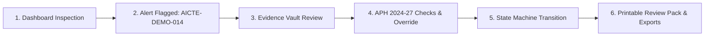

# AIClear: Hackathon Showcase Walkthrough (2–4 Minute Judge Guide)

> **Institutional Statement:**  
> AIClear is an independent institutional workflow automation, compliance monitoring, and alert management system built for technical colleges preparing for AICTE approval under the official **Approval Process Handbook (APH) 2024–2027**.  
> **AIClear does NOT claim official AICTE endorsement or automatic statutory sanction.** All compliance evaluations are explainable, traceable, and subject to human institutional review.

---

## 2–4 Minute Live Judge Demonstration Flow

---

### Step 1: Institutional Operations Dashboard (0:00 – 0:30)
1. **Visual Aesthetic:**
   - Notice the administrative workstation theme: warm neutral palette (`#F7F7F5`), slate text (`#1A1917`), crisp borders (`#E2E0D8`), and tabular numerals (`font-tabular`). No purple gradient or generic AI neon styles.
2. **Data Mode Banner:**
   - Observe the active mode indicator: **`[DEMO MODE]` (Synthetic evaluation data)**.
   - Point out that synthetic records are strictly isolated from imported records, and the system never blends mock data with authentic institutional data.
3. **KPIs & Metrics:**
   - 4 Active Cases, 1 Completed Case, 1 Approaching Deadline, 1 Flagged Deficiency.

---

### Step 2: Operational Alert Flagged on Case `AICTE-DEMO-014` (0:30 – 1:00)
1. **Navigate to the Alerts Queue:**
   - Observe the top alert:
     > **`[HIGH] Document Expiry: Fire Safety Certificate Approaching Expiration`**  
     > *Case Ref: `AICTE-DEMO-014` | Assigned: `A. Coordinator`*
2. **Click on the Case Link `[AICTE-DEMO-014]`:**
   - Opens the institutional Case Management modal.

---

### Step 3: Evidence Vault & Multi-Format Document Management (1:00 – 1:30)
1. **Switch to the "Evidence Vault" Tab:**
   - Observe the attached files:
     - `Fire_Safety_NOC_Municipal_2024.pdf` (Category: `FIRE_SAFETY_NOC`)
     - Review status: `AWAITING_REVIEW`
     - SHA-256 Checksum: Cryptographic hash calculated on upload (`4ccb16d8...`).
2. **Review & Versioning Actions:**
   - Click **"Validate Valid"** to simulate compliance officer verification.
   - Click **"+ Replace with Revised Version"**: Demonstrate non-destructive versioning (increments from `v1` to `v2` without deleting prior audit history).

---

### Step 4: Deterministic APH 2024–2027 Compliance Audit & Override (1:30 – 2:15)
1. **Switch to the "Compliance Checks" Tab:**
   - Click **"⚡ Re-evaluate Checks"**:
     - Evaluates attached documents and case metadata against the official 2024–2027 Handbook.
   - Observe Rule **`APH-2024-FIRE-002: Valid Fire Safety Certificate / NOC`**:
     - **Citation:** *AICTE Approval Process Handbook 2024-27 (Chapter I/II Mandatory Documents, Appendix 16)*.
     - **Status:** Flags `NEEDS_REVIEW` or `EXPIRED_EVIDENCE` with clear explanation.
     - Note the badge: **`OFFICIAL APH 2024–27`** vs demo rules tagged **`ILLUSTRATIVE DEMO RULE`**.
2. **Demonstrate Traceable Human Override:**
   - Click **"Record Override"** on the rule card.
   - Target Status: Select `COMPLIANT`.
   - Justification: Enter *"Physical fire NOC renewal receipt #58204 verified with Municipal Fire Division Chief"*.
   - Click **"Commit Human Override to Audit Trail"**:
     - Result instantly displays a `MANUAL OVERRIDE` badge.
     - Shows: *Overridden by Compliance Officer | Automated was: NEEDS_REVIEW | Reason: "..."*.
     - Written to the immutable `audit_events` table.

---

### Step 5: Workflow State Machine & Stage Transition (2:15 – 2:45)
1. **Switch to the "Workflow Transition" Tab:**
   - Notice the current stage: `Document Review`.
   - The Target Next Stage dropdown only permits valid stages per the state machine (`COMPLIANCE_CHECKS`, `CORRECTIONS_REQUIRED`, `DRAFT`).
   - Illegal transitions (e.g. attempting to jump straight to `READY_FOR_SUBMISSION`) are rejected by backend validation guards.
2. **Advance Case Stage:**
   - Select `Compliance Checks`.
   - Enter justification: *"All mandatory statutory attachments verified and ready for compliance committee audit"*.
   - Click **"Advance Case Stage"**.
   - Observe the stage stepper banner updating live to `3. Compliance Checks`, with the transition logged in the permanent audit trail.

---

### Step 6: Generate Printable Internal Review Pack & Exports (2:45 – 3:30)
1. **Click "📄 Review Pack" in the Header:**
   - Opens the comprehensive **Internal Review Pack & Audit Dossier**.
2. **Inspect Dossier Sections:**
   - **Mandatory Legal Disclaimer:** Prominently featured on header and footer.
   - **Executive Readiness Summary:** Readiness score (`80%` or `100%`), verified document counts, passed vs deficient rules.
   - **Evidence Vault Inventory Table:** SHA-256 hashes, validity dates, review states.
   - **APH Compliance Audit Checklist:** Citations to APH 2024–27 clauses.
   - **Workflow Stage Audit Trail:** Every transition actor and timestamp.
   - **Formal Sign-Off Blocks:** Case Coordinator, Compliance Officer, and Head of Institution signature spaces.
3. **Export Actions:**
   - Click **"🖨️ Print Dossier / PDF"**: Uses print stylesheet (`@media print`) to generate a clean institutional document or PDF.
   - Click **"📥 Download JSON"**: Downloads complete case history dossier in machine-readable JSON.

---

### Step 7: Data Mode Boundary Hardening Proof (3:30 – 4:00)
1. **Data Source Settings Modal:**
   - Click **`DEMO`** badge in top navigation bar ➔ Click **"Switch Data Mode"**.
   - Switch to **`IMPORTED` Mode**:
     - Dashboard dynamically updates to display ONLY user-imported cases (PIAT-EOA-2025, GECT-NOC-2025, etc.). Zero demo cases leaked.
2. **Reset Demo Workspace Safety Test:**
   - In Settings Modal, click **"Reset Demo Data"**:
     - Re-seeds the 5 canonical demo cases.
     - Authentic imported institutional records remain **100% untouched and preserved**.

---

## Key Regulatory & Architectural Highlights for Judges

| Evaluation Dimension | How AIClear Satisfies It |
| :--- | :--- |
| **Authentic AICTE Citations** | Official rules link directly to APH 2024–27 chapters & appendices (e.g. Appendix 16 for Fire NOC, Appendix 7 for FSR, Appendix 4 for Land). Zero fabricated regulatory claims. |
| **Data Mode Boundary** | Strict physical and logical boundary (`DEMO`, `IMPORTED`, `MANUAL`, `CONNECTED`). Never silently blends synthetic and real data. |
| **Evidence Integrity** | SHA-256 cryptographic hashing on all uploaded files. Non-destructive versioning increments versions without destroying audit history. |
| **Traceable Governance** | Automated checks can be overridden by human officers, but automated findings and human justifications are permanently preserved in audit logs. |
| **Realistic ONOD Assessment** | Accurately classifies AICTE ONOD and Portal as `VERIFIED-RESTRICTED` (requires institutional NETF credentials; no fake public REST API). |
